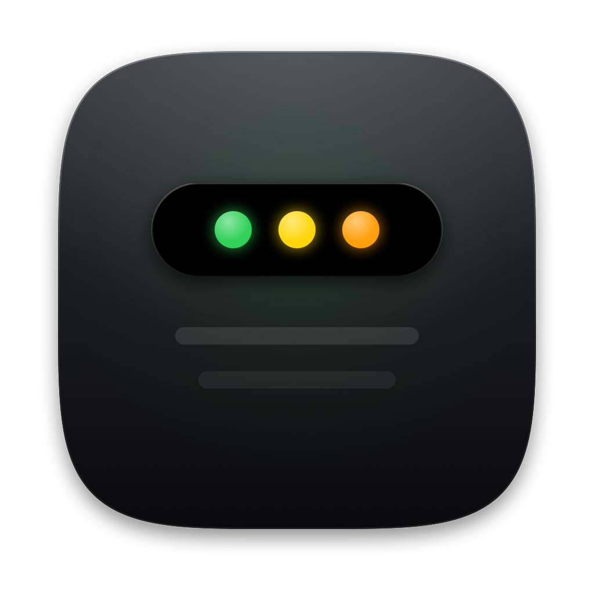
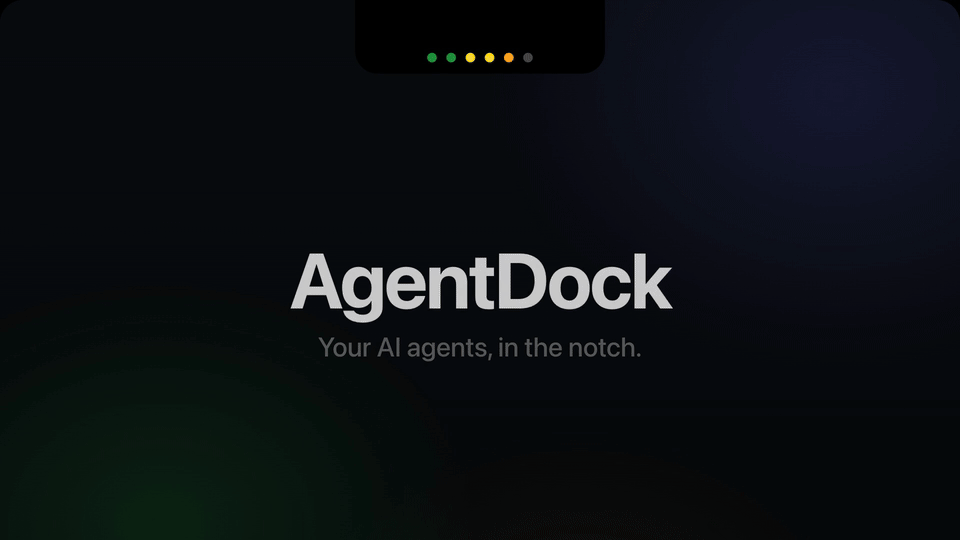

# AgentDock

**A tiny macOS notch island that shows which of your AI coding agents are actually working, on this Mac and on your other Macs.**

[](docs/demo.mp4)

▶ [Watch the full 20-second demo (with sound)](docs/demo.mp4)

Collapsed, AgentDock hangs under the camera notch as a row of colored dots. Click it and it expands into a Dynamic-Island-style panel showing the 6 most active agents and the Mac each one runs on.

## Features

- **Lives in the notch.** Up to 6 status dots, always visible, with no window to manage. Click to expand, click again to collapse.
- **Every Mac at once.** Remote Macs are probed read-only over SSH (Tailscale works well). Use the **This Mac / All Macs** toggle in the panel to skip SSH hosts. The setting is remembered.
- **Zero intrusion.** No hooks, no plugins, no status files for agents to write, and no tokens spent. It only looks at processes and file modification times.
- **14 agents out of the box:** Claude, Codex, Cursor, Gemini, OpenCode, Copilot, Goose, Droid, Devin, Qoder, Hermes, Agent Zero, Amazon Quick and Ollama. Adding another takes four lines of YAML.

## How it works

Every 10 s, [`lib/detect.py`](lib/detect.py) checks two things for each agent in the catalog:

- **Processes:** a `pgrep`/`ps` substring match against `process_patterns`.
- **Session files:** the newest mtime among `session_globs` (transcripts, session logs).

Remote hosts get the same read-only probe over one multiplexed SSH connection.

| Dot | Status | Meaning |
|---|---|---|
| 🟢 | running | Process alive and a session file was written < 2 min ago |
| 🟡 | idle | Process alive, no session writes for > 2 min (process-only agents never go above idle) |
| 🟠 | stale | No process, but a session file was written < 1 h ago |
| ⚫ | offline | No process and nothing recent (or the host is unreachable) |

Agents with neither a process nor session files are hidden. The rest are sorted by status, then by recency, and the top `max_dots` are shown.

## Install

Requires macOS 14+ and `python3` (system Python is fine; PyYAML is optional).

**Prebuilt:** download `AgentDock.zip` from [Releases](https://github.com/jesselei1102-hue/agentdock/releases) (or the latest [Actions](https://github.com/jesselei1102-hue/agentdock/actions) build artifact), unzip it and drag **AgentDock.app** into **/Applications**.

**From source** (Xcode 15+):

```sh
git clone https://github.com/jesselei1102-hue/agentdock.git
cd agentdock/native
xcodebuild -project AgentStatusBar.xcodeproj -scheme AgentStatusBar \
  -configuration Release -derivedDataPath build CODE_SIGNING_ALLOWED=NO build
ditto build/Build/Products/Release/AgentDock.app /Applications/AgentDock.app
codesign --force --deep -s - /Applications/AgentDock.app   # ad-hoc sign
```

The app is unsigned, so on first launch right-click it and choose **Open** (or run `xattr -cr /Applications/AgentDock.app`).

## Open, quit and launch at login

- **Open:** Launchpad, Spotlight (⌘Space → "AgentDock") or Finder → Applications. There is no Dock icon; the app lives in the notch.
- **Quit:** expand the island and click the **⏻** button in its header, or **right-click** the island → **Quit AgentDock**. The menu bar fallback icon has a Quit item too (it is often hidden behind the notch).
- **Right-click menu:** This Mac Only, Launch at Login, Refresh, Quit AgentDock.
- **Launch at login:** turned on automatically the first time AgentDock runs from `/Applications`. Turn it off from the right-click menu or in **System Settings → General → Login Items**. If macOS asks for approval, enable AgentDock there.

To regenerate the app icon, run `swift scripts/make_icon.swift` from the repo root.

`detect.py` and `agents.yaml` are bundled inside the app. To run against a checkout instead, set `AGENTDOCK_DETECT=/path/to/lib/detect.py`.

### CLI

The detector works on its own too:

```sh
python3 lib/detect.py --format json      # what the app sees
python3 lib/detect.py --local-only       # skip SSH hosts
python3 lib/detect.py --demo             # fake data, no pgrep/SSH
```

## Configuration

The config lives at `~/.config/agentdock/config.yaml`. Override the path with `AGENTDOCK_CONFIG`. A commented template is written on first run; see [`config.example.yaml`](config.example.yaml).

```yaml
local:
  label: "MacBook"        # blank = show agent names without a suffix
hosts:                    # zero or more remote Macs
  - id: studio
    label: "Studio"
    ssh: mac-studio       # Host alias in ~/.ssh/config, e.g. a Tailscale name
idle_after_sec: 120
stale_after_sec: 3600
max_dots: 6
```

Remote hosts need key-based, non-interactive SSH (`BatchMode=yes`). If a host is unreachable, the probe times out after 3 s and the host shows up as a single gray dot.

## Adding agents

The catalog lives in [`lib/agents.yaml`](lib/agents.yaml):

```yaml
- id: myagent
  name: My Agent
  process_patterns: ["bin/myagent"]
  session_globs: ["~/.myagent/sessions/*.jsonl"]
```

To add or override entries locally, put them under `agents:` in your config (an entry with the same `id` overrides the built-in one). PRs that extend the catalog are welcome. Keep each list on one line so the no-PyYAML fallback parser can read it.

## Limitations

- Activity is a heuristic: a recent session-file write counts as "running".
- The Codex app-server and some desktop apps stay alive in the background, so they show as idle even when nothing is open.
- Plain Claude desktop chat (not Cowork) writes no reliable activity file, so it shows as idle. Desktop apps such as Qoder, Devin and Amazon Quick may write caches or IndexedDB while idle, which can keep them green longer than real work.
- Process-only agents (Ollama) cap at idle.
- The remote probe runs `ps` and `stat` over SSH, so remote hosts must run macOS or Linux.

## License

[MIT](LICENSE)
